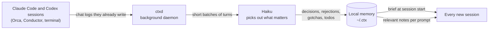

# ctx

**Shared memory for your AI coding agents.**

You run several Claude Code and Codex sessions on the same project, maybe in Orca, Conductor
or a plain terminal. Each one starts blank. It doesn't know what the others decided, what you
already rejected, or which trap cost you an hour yesterday.

`ctx` fixes that. It quietly reads the chat logs your agents already write, keeps a short
memory of what matters, and hands that memory to every new session. It works with chats that
are still open, so nothing has to finish first.

- Runs locally. Your chats stay on your machine.
- No MCP server and no plugin to install in each tool.
- Costs a few cents a day, with a hard daily cap.



## What a new session sees

When a session starts, the agent gets a short brief like this one:

```text
Shared memory for project my-app (github.com/you/my-app) from other agent sessions on this machine.
## Other recent sessions on this project
- conductor/codex · feature/billing · 12m ago · "Add Stripe checkout", last ask: "make the webhook idempotent"
## Rejected (don't redo without asking)
- [f3k9a2c] Do not add a Redis cache for the dashboard. Why: overkill for v1, an index fixed it (user · orca · 10-23)
## Decisions
- [f7q1x8d] Use SQLite, not Postgres. Why: single user, no server to run (agreed · cli · 10-22)
## Gotchas
- [fm2p4ve] Vitest 3 hangs on Node 26; keep Node 24 pinned in .nvmrc (agreed · codex · 10-24)
## Open todos
- [fz6t0rb] Add rate limiting to /signup (user · orca · 10-24)
```

Later in the chat, when you ask about something from the past, up to 3 matching notes are
added to your prompt. If nothing matches well, nothing is added.

## How it works

1. **Capture.** A small daemon, `ctxd`, watches the chat logs that Claude Code
   (`~/.claude/projects`) and Codex (`~/.codex/sessions`) write after every turn. It removes
   secrets, then stores each turn: your message, the agent's reply, and a one-line summary of
   each tool call.
2. **Remember.** Every few turns, a cheap model (Haiku, through your own `claude` login) reads
   the new turns and writes down only what should change how a future session acts. Most
   batches produce nothing, by design.
3. **Recall.** Hooks in Claude Code and Codex give each new session its brief and add
   relevant notes to prompts. Agents can dig further with `ctx search` and `ctx show`.

More detail, with diagrams: [docs/ARCHITECTURE.md](docs/ARCHITECTURE.md). Why it is built
this way: [docs/RESEARCH.md](docs/RESEARCH.md).

## Requirements

- macOS (launchd) or Linux (systemd user service)
- [Bun](https://bun.sh) (tested with 1.4)
- [Claude Code](https://code.claude.com) installed and logged in. It powers the memory step.
- Codex is optional. If you use it, `ctx` reads its sessions too.

## Install

```sh
git clone https://github.com/adityaaggarwal12/ai-ctx.git
cd ai-ctx
bun install
bun src/cli.ts install          # dry run: lists every file it would change
bun src/cli.ts install --apply  # installs and starts the daemon
ctx doctor                      # checks that everything is wired up
```

`install --apply` does four things:

- copies the app to `~/.ctx/app` and puts a `ctx` command in `~/.local/bin`
- adds two hooks to `~/.claude/settings.json` and `~/.codex/hooks.json`
- adds a short note about `ctx` to `~/.claude/CLAUDE.md` and `~/.codex/AGENTS.md`
- starts `ctxd` as a background service

Every file it changes gets a backup next to it. To remove everything, run
`ctx uninstall --apply`.

**Using Codex?** Open `/hooks` in Codex once and approve the two `ctx` hooks. Codex skips
hooks you haven't approved, without any warning.

**First run.** `ctxd` reads your existing chat history, which takes about a minute. It also
downloads a small search model (about 300 MB) the first time it starts.

## Everyday use

| You want to | Run |
|---|---|
| See what a new session sees | `ctx brief` |
| Find a past discussion | `ctx search "refresh tokens"` (add `--all` for every project) |
| Open an id from a brief or note | `ctx show f1a2b3c` or `ctx show t:1a2b3c4d.12` |
| See what other sessions are doing now | `ctx sessions`, then `ctx tail <session>` |
| Save something by hand | `ctx note "..." --why "..."`, `ctx reject "..." --why "..."`, `ctx todo "..."` |
| Fix memory | `ctx retract <id>`, `ctx done <id>`, `ctx keep <id>` |
| Clean up | `ctx review` (old items), `ctx dedupe` (duplicates) |
| Check health and cost | `ctx status`, `ctx doctor` |
| See and clean everything in a browser | `ctx ui` |

## Review page

Run `ctx ui` to open a local page in your browser. It has four tabs:

- **Projects**: every project with the exact brief a new chat receives, and its size in tokens
- **Facts**: what needs review (old todos and gotchas, unconfirmed guesses) and duplicate
  pairs, with Done, Retract, Keep and Merge buttons, plus a box to add a note
- **Sessions**: live and recent chats across Orca, Conductor and the terminal, with their
  latest turns
- **Health**: daemon status, hooks, today's cost, backfill progress, and how often notes
  get added to prompts

The page is served by `ctxd` on `127.0.0.1:7770` only, so other machines can't reach it.
`ctx ui` opens it with a secret link that becomes a cookie. Requests from other websites
or other host names are refused. Every button records a normal memory change, the same as
the matching `ctx` command. The page is off until you first run `ctx ui`, and `ctx ui --off`
turns it off again.

Hooks only reach chats started after the install. In a chat that was already open, ask the
agent to run `ctx brief`.

## What is stored, and where

Everything lives in `~/.ctx`, readable only by you.

| Path | What it holds |
|---|---|
| `archive/<machine>/` | Cleaned copies of every turn. The source of truth, because Claude Code deletes old logs on its own. |
| `events/<machine>/` | An append-only log of every memory change. `ctx rebuild` replays it. |
| `index.sqlite` | Search index and the current list of facts. It can be rebuilt from the two folders above. |
| `projects/<name>/LIVE.md` | A readable copy of each project's memory. |

**Privacy.**

- Secrets (API keys, tokens, passwords, private keys) are removed before anything is stored
  or sent anywhere.
- The only thing that leaves your machine is the memory step: short, cleaned batches of
  turns sent to Haiku through your `claude` login.
- Search runs on a local model. File contents and diffs are never stored or sent.

## Cost

Each memory call costs about $0.004 at list price. The default cap is 200 calls a day, so
the most it can spend is about $0.80 a day. Typical use is far lower. `ctx status` shows
today's calls and cost.

New installs only process the last 10 days of history. To process older history once, run
`ctx backfill --days 60`. Add `--dry-run` to see the cost first.

## Configuration

Settings live in `~/.ctx/config.json`. All are optional.

| Setting | Default | What it does |
|---|---|---|
| `extract.model` | `haiku` | Model used for the memory step |
| `extract.maxCallsPerDay` | `200` | Daily cap on memory calls |
| `extract.horizonDays` | `10` | Only turns this recent are processed. Older ones stay searchable. |
| `brief.maxChars` | `6000` | Size limit for the session brief |
| `brief.staleDays` | `30` | Todos and gotchas not confirmed for this long leave the brief. `ctx review` lists them. |
| `recall.minSim` | `0.53` | How close a note must be to your prompt before it is added. `ctx recall-stats` helps tune it. |
| `recall.maxSnippets` | `3` | Most notes added to one prompt |
| `ui.port` | `7770` | Port for the review page (always bound to 127.0.0.1) |
| `embed.enabled` | `true` | Local vector search. Set `false` to use keyword search only. |
| `branchScopedRepos` | `[]` | Repos where each branch is its own project, such as a playground repo with one idea per branch |
| `mixedProjects` | `[]` | Catch-all folders with unrelated work. Their brief shows only sessions and preferences; topic notes arrive per prompt. |
| `projectAliases` | `{}` | Let a project also see the memory of older project ids, for example after moving a repo |
| `ignoreCwd` | ctx's own folders | Path fragments whose sessions are never read |

## Limitations

- Laptop only for now. Syncing memory between machines is planned, not built.
- Only Claude Code and Codex. Browser chats (ChatGPT, claude.ai) are out of scope.
- The memory step sometimes saves more than it should. `bun run eval` measures this, and
  `ctx review` and `ctx dedupe` clean it up.

## Development

```sh
bun test                      # unit and integration tests
bunx tsc --noEmit -p .        # type check
bun run eval                  # memory quality check (about 15 Haiku calls, ~$0.01)
CTX_HOME=/tmp/ctxtest bun src/cli.ts scan   # try it against a throwaway store
```

The daemon runs from the copy in `~/.ctx/app`. After changing code, run
`bun src/cli.ts install --apply` again so the daemon picks it up.

`bun run eval` sends 15 labelled conversations through the real memory prompt and reports
what it found, what it missed, and what it saved by mistake. Run it before and after you
change the prompt in `src/extract.ts`.

## License

[MIT](LICENSE)
