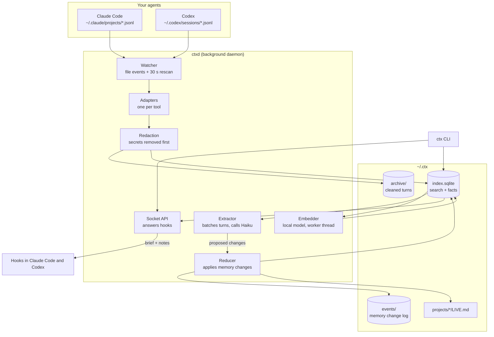
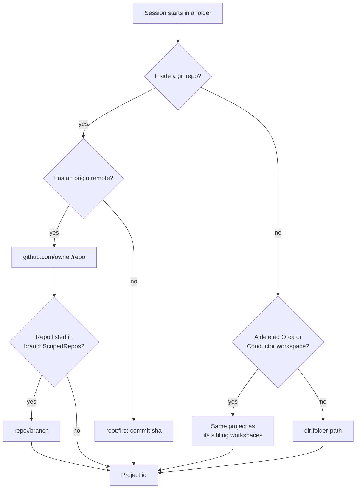
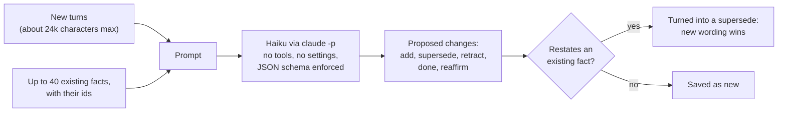
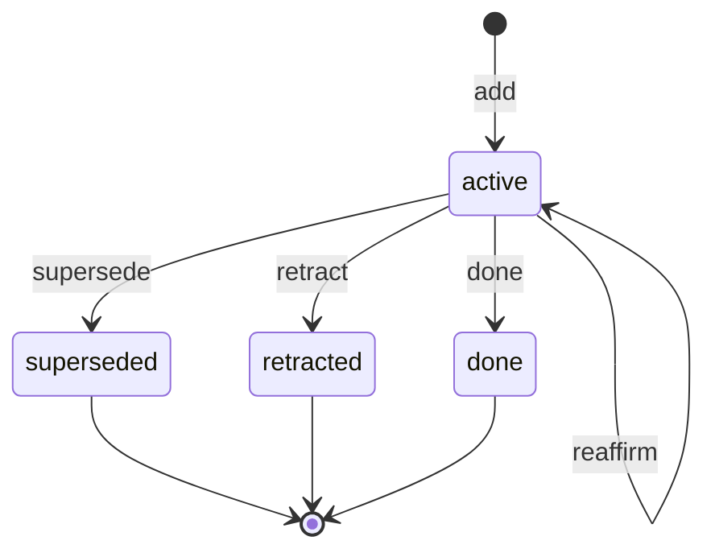
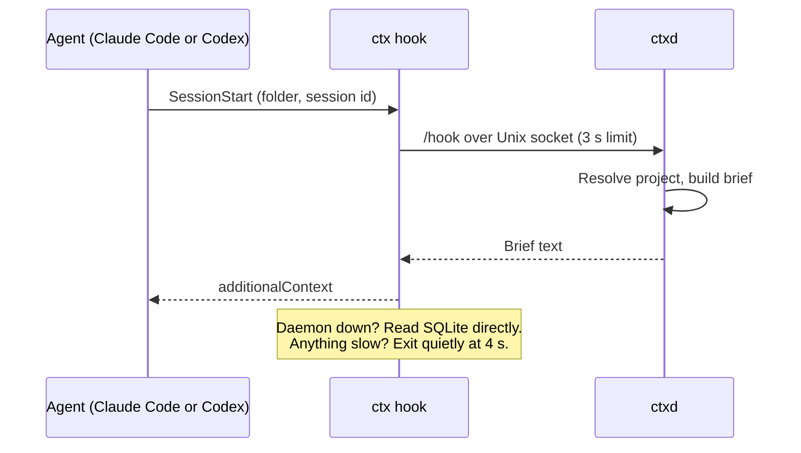
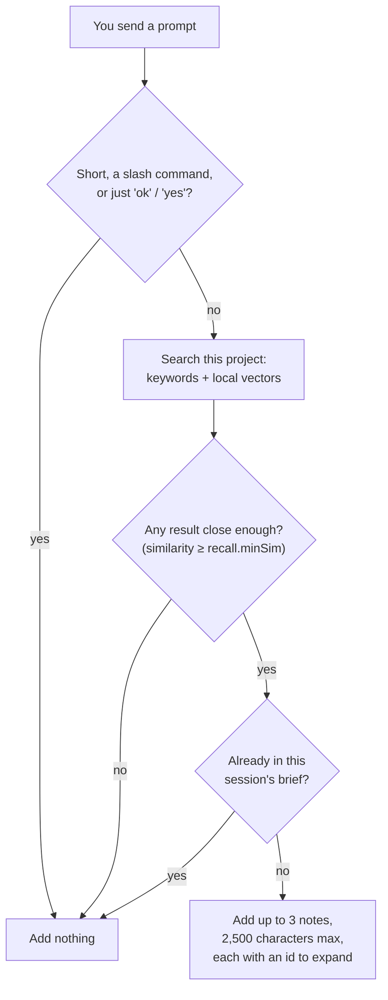

# How ctx works

This page explains what happens between an agent writing a chat log and another agent getting
a brief. For why it is built this way, see [RESEARCH.md](RESEARCH.md).

## The big picture

There is one process that writes: `ctxd`. The `ctx` command and the hooks talk to it over a
Unix socket. If `ctxd` is down, they read the database directly and fall back to keyword
search, so your agents never wait on it.

## 1. Capture

Claude Code and Codex append to a JSONL log after every turn. `ctxd` reads only the new bytes
of each file and remembers its position, so nothing is read twice. File system events
trigger a read within half a second. A full rescan every 30 seconds catches anything the
events missed.

Each tool has an adapter (`src/adapters/claude.ts`, `src/adapters/codex.ts`) that turns raw
log records into one shape:

| Field | What it holds |
|---|---|
| `user` | Your message, cleaned of injected system text |
| `assistant` | The agent's reply text |
| `tools` | One line per tool call, such as `$ npm test → exit 1` or `edit src/app.ts` |
| `files` | Paths the agent edited |
| `branch`, `cwd`, `harness` | Where it happened: Orca, Conductor, Codex or a terminal |

What gets skipped:

- tool output, file contents and diffs (never stored)
- subagent chats, compaction summaries and task notifications
- helper calls from tools, like Orca's chat-title generator
- any `<ctx-context>` block that `ctx` itself injected, so memory never feeds on itself

Secrets are removed **before** anything is truncated, stored or sent. The rules cover common
key formats (Anthropic, OpenAI, GitHub, AWS, Stripe, Slack and more), JWTs, bearer tokens,
passwords in URLs, private keys, and `key=value` pairs whose name suggests a secret.

A turn is complete when the agent finishes its reply, or after 10 minutes without activity.
Long replies are trimmed to the first 1,500 and last 4,500 characters. The end of a reply
usually holds the outcome.

## 2. Which project is this?

Many folders can belong to one project, for example several git worktrees of one repo in
Orca and Conductor. `ctx` gives them all the same project id.

A session keeps the project of the folder it started in, even if the agent later `cd`s
elsewhere.

Three settings adjust this:

- **`branchScopedRepos`**: a repo where each branch is a separate idea gets one project per
  branch.
- **`projectAliases`**: a new project id can also see the memory of an old one, for example
  after moving a branch into its own repo.
- **`mixedProjects`**: a catch-all folder where you start agents for unrelated tasks. Its
  brief skips topic facts, which would mostly be about other tasks.

## 3. Remember

### When extraction runs

Every 20 seconds, `ctxd` looks for sessions with new completed turns. A session is ready when
it has 3 or more new turns, or when it has been idle for 2 minutes. The newest sessions go
first, so a fresh chat gets its memory quickly even during a large backfill.

### What the model sees

The prompt tells the model that the right answer is usually "nothing". It may only save:

| Type | Example |
|---|---|
| `decision` | Use SQLite, not Postgres. Why: single user. |
| `rejected` | Do not add a Redis cache. Why: overkill for v1. |
| `preference` | Answer with short checklists, not long prose. |
| `gotcha` | Vitest 3 hangs on Node 26; keep Node 24. |
| `todo` | Add rate limiting to /signup later. |
| `progress` | v1 is live in production. |

Each saved fact records who it came from:

- **user**: you said it
- **agreed**: the agent proposed it and you went along
- **agent**: the agent assumed it

Facts from `agent` stay out of the brief unless the model is very confident.

### Duplicates

The model only sees about 40 existing facts, so on big projects it can save a reworded copy
of something already known. Before saving, `ctx` compares the new fact with every fact of
the same type in the project. If the words overlap enough (Jaccard similarity 0.45 or more),
the new fact replaces the old one instead of sitting next to it. It keeps the stronger
origin, so restating your words never downgrades them. `ctx dedupe` applies the same check to
memory you already have.

### The memory log

Memory is never edited in place. Every change is appended to `events/<machine>/YYYY-MM.jsonl`,
and a reducer applies it to the `facts` table. Rebuilding from the log always gives the same
result, which makes mistakes easy to undo and keeps the door open for syncing machines.

- **supersede**: a newer fact replaces this one.
- **retract**: it was wrong (`ctx retract`).
- **done**: a todo was finished (`ctx done`).
- **reaffirm**: it is still true, so its age resets (`ctx keep`).

Each fact is dated by the turn it came from, not by when extraction ran. That keeps a
backfill from making old facts look new.

## 4. Recall

### The session brief

The brief holds, in order:

1. other sessions on this project from the last 3 days, with their latest question
2. rejected ideas
3. decisions
4. your preferences
5. gotchas
6. open todos
7. progress from the last 7 days

It is capped at 6,000 characters. Todos and gotchas that nobody has confirmed for 30 days
drop out, with a pointer to `ctx review`.

### Notes per prompt

Silence is the default. Adding text to every prompt makes agents drift and slows them
down, so a note only appears when it clearly matches.

### Search and ranking

Search combines two methods:

- **Keywords**: SQLite FTS5 with BM25, matching any of the important words in the query
- **Meaning**: cosine similarity over vectors from EmbeddingGemma-300M, which runs locally
  in a worker thread

The two ranked lists are merged with reciprocal rank fusion (k = 60). Then:

- facts score 1.5 times higher than raw turns, and rejected ideas 1.8 times higher
- recent items get a small boost that fades over about 45 days

Vectors cover the last 90 days. Older turns stay findable by keyword. A query vector has
600 ms to compute; past that, the hook answers with keywords alone.

Every searched prompt logs its scores (never the prompt itself) to `logs/recall.jsonl`.
`ctx recall-stats` shows where scores fall around `recall.minSim`, which helps tune it as
memory grows.

## 5. Timing and limits

| What | Limit |
|---|---|
| Hook timeout set in Claude Code and Codex | 5 s |
| `ctx hook` hard exit | 4 s |
| Wait for the daemon | 2.5 s per prompt, 3 s at session start |
| Query vector | 600 ms, then keywords only |
| Memory calls | 200 a day by default |
| Input per memory call | about 24,000 characters |
| Extraction window | last 10 days, or further with `ctx backfill` |

Measured on the author's Mac: a hook answers in 80 to 300 ms through the daemon, or about
50 ms when reading SQLite directly. A memory call on a 5-turn batch takes about 20 seconds
and costs about $0.004 at list price.

## 6. Housekeeping

| Job | How often |
|---|---|
| Rescan chat logs | every 30 s |
| Close idle turns | every 15 s (after 10 min idle) |
| Extract memory | every 20 s, up to 3 sessions |
| Embed new turns and facts | every 10 s |
| Refresh `LIVE.md` files | every 5 min |
| Compact the archive (drop older copies of a turn) | once a day |

## 7. Measuring memory quality

`bun run eval` runs 15 hand-labelled conversations (in `eval/cases.json`) through the real
extraction prompt. It reports:

- facts it should have saved, and did
- facts it saved by mistake
- any secret that leaked into memory

Cases cover each fact type and things that must produce nothing, such as routine edits,
questions and the agent's own guesses.

Current baseline: every expected fact is found, but the model adds about 6 extra facts
across 15 cases. It tends to restate one event as two facts, and to log routine work as
progress. Tighten the prompt, then rerun the eval to confirm.

## 8. Lessons from building it

These came from testing against real history (about 9,000 turns from 170 sessions):

- **Embeddings run in a worker thread.** On the main thread, a large backfill froze hook
  answers.
- **Extraction starts with only the last 10 days.** Otherwise installing would kick off
  hundreds of model calls on old history.
- **The app is copied to `~/.ctx/app`.** Deleting or archiving the source folder can't break
  the hooks.
- **Codex hooks are added at the end of each list.** Codex remembers approvals by position,
  so inserting first would quietly un-approve other tools' hooks.
- **The recall threshold (0.53) came from real queries.** Relevant matches scored 0.55 to
  0.68 and unrelated ones 0.39 to 0.51. It is a small sample, so `ctx recall-stats` exists
  to re-check it.
- **A catch-all folder needs different treatment.** One scratch folder had collected 136
  facts about unrelated tasks, so mixed folders now get a brief without topic facts.

## 9. Not built yet

- **Syncing between machines.** The plan: each machine writes only its own `archive/` and
  `events/` folders and syncs them with Syncthing or git. The daemon would need to pick up
  new event lines as they arrive (today it only replays the log on a fresh start).
- **Tighter extraction prompt**, guided by the eval.
- **A check of facts against git**, to flag facts about files that changed since.
