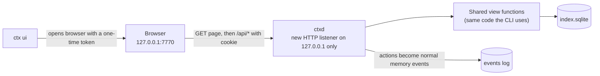

# Plan: a small local UI for ctx

Status: proposal, not built.

## Why

Agents use `ctx` through hooks and the command line, and that works well for them. People
need something else. Three jobs are awkward in a terminal:

1. **Cleaning memory.** `ctx review` prints ids that you then copy into `ctx done`,
   `ctx retract` or `ctx keep`, one command at a time.
2. **Seeing what an agent gets.** It is hard to judge a brief's size and content for a
   project you are not currently inside.
3. **Checking health and cost at a glance.** That takes `ctx status`, `ctx doctor` and
   `ctx recall-stats` together.

The UI covers these three jobs and nothing more.

## What similar tools do

- **claude-mem** ships a viewer at `localhost:37777`: a live feed of saved memories
  filtered by project, with light and dark themes, built in React and served by its
  worker process. It is mostly a feed to watch, not a place to clean up.
- **Lesson for ctx:** watching memory scroll by is less useful than fixing it. The
  Facts tab is built around review actions, not a live feed.
- **Security lesson:** a server on localhost is not automatically private. Any web page
  you visit can send requests to `localhost`, and DNS rebinding can get around the
  browser's same-origin checks. Local tools have shipped real bugs here, including the
  MCP TypeScript SDK and Open WebUI. The UI needs its own access check, described below.

## Scope

**In:**

- one page with four tabs: Projects, Facts, Sessions, Health
- five fact actions: done, retract, keep, merge duplicates, and saving a new note
- the brief preview exactly as an agent receives it, with its size in tokens
- light and dark themes that follow the system setting

**Out:**

- editing fact text (retract it and write a new note instead)
- charts beyond one small histogram
- any access from other machines, accounts or logins
- a build step, a framework or new dependencies
- reading or showing raw transcripts beyond what `ctx show` already prints

## How it works



- **Server.** `ctxd` already runs a Bun server on a Unix socket. It gains a second
  listener bound to `127.0.0.1` only (port 7770 by default, `ui.port` in config). The UI
  is off unless `ui.enabled` is true, and `ctx ui` turns it on the first time.
- **Page.** It is plain HTML, CSS and JavaScript in `src/ui/`, with no build step, served
  by `ctxd`. It refreshes every 10 seconds while the tab is visible. That is simpler than
  a live stream and fast enough for this job.
- **One source of logic.** The queries behind `ctx review`, `ctx dedupe`,
  `ctx recall-stats` and `ctx status` currently live inside `cli.ts`. They move into
  `src/views.ts`, so the CLI and the UI show the same numbers.
- **Actions are normal events.** Done, Retract and Keep emit the same events as the CLI,
  so they are logged, replayable and undoable like everything else.

## Access control

1. **Token.** `ctxd` creates a random 32-byte token in `~/.ctx/runtime/ui-token` (mode
   0600). `ctx ui` opens `http://127.0.0.1:7770/?t=<token>`. The server swaps it for an
   `HttpOnly`, `SameSite=Strict` cookie and redirects to strip the token from the URL.
   Every `/api` call needs that cookie.
2. **Host check.** Requests whose `Host` header is not `127.0.0.1:<port>` or
   `localhost:<port>` are refused. This blocks DNS rebinding.
3. **Origin check on writes.** Changes need a POST whose `Origin` matches the UI's own
   origin. This blocks other sites submitting forms to it.
4. **Bound to 127.0.0.1 only**, so it is never reachable from the network.

## The four tabs

Rough sketches, filled with example data. The real page will be simpler to read than ASCII.

### Projects

```text
┌ ctx ─────────────────────────────────────────────── Projects  Facts  Sessions  Health ┐
│ Search projects…                                                                      │
│                                                                                       │
│ PROJECT                 SESSIONS  FACTS  BRIEF       LAST ACTIVE                      │
│ ▸ ai-ctx                      3     18   1,372 tok   2m ago                           │
│ ▸ dailydesk  (alias: news)    4     44   1,460 tok   5d ago                           │
│ ▸ claude     (mixed)         67    127     777 tok   4h ago                           │
│                                                                                       │
│ ── dailydesk: brief preview (exactly what a new chat receives) ───────────────────── │
│ ## Rejected (don't redo without asking)                                               │
│ - [fba22id] Do not use the warm Gilded Night palette…                                 │
│ ## Decisions                                                                          │
│ - [fcwohve] Enforce a $50 monthly AI spend cap…                       [ 1,460 tokens ]│
└───────────────────────────────────────────────────────────────────────────────────────┘
```

### Facts

```text
┌ Facts ─ project: [dailydesk ▾]  type: [all ▾]  show: [● needs review ○ all active]   ┐
│                                                                                       │
│ 3 old todos/gotchas · 2 unconfirmed · 1 duplicate pair                                │
│                                                                                       │
│ todo     35d  Remove suno subdomain from the shared proxy      agent   [Done][Retract][Keep] │
│ gotcha   31d  Feeds that list their whole archive re-add…      agreed  [Done][Retract][Keep] │
│                                                                                       │
│ Duplicate:  [fxasbmi] Agent sessions cannot read ~/Downloads…                         │
│        ≈    [fffl96t] The agent sandbox cannot read ~/Downloads…   [Merge into newer]  │
│                                                                                       │
│ [+ Add note]  type [decision ▾]  text [______________________]  why [__________]      │
└───────────────────────────────────────────────────────────────────────────────────────┘
```

"Needs review" is the default view: the same list as `ctx review`, plus duplicate pairs.
Clicking a fact shows its source turn, quote and history (superseded by, merged from).

### Sessions

```text
┌ Sessions ─ project: [all ▾] ─────────────────────────────────────────────────────────┐
│ ● live  orca/claude    ai-ctx      "Central context infrastructure…"   2m ago  12 turns│
│ ○       cli/claude     dailydesk   "Move news into its own repo"       1h ago  31 turns│
│ ○       conductor/codex news       "Morning brief fallback"            5d ago   9 turns│
│                                                                                       │
│ ▾ latest turns (same as ctx tail)                                                     │
│   USER: merge and push                                                                │
│   AGENT: Fast-forwarded main and pushed f8d41c4…                                      │
└───────────────────────────────────────────────────────────────────────────────────────┘
```

### Health

```text
┌ Health ──────────────────────────────────────────────────────────────────────────────┐
│ ✓ ctxd running (pid 84924, up 31m)   ✓ hooks: Claude 2/2, Codex 2/2 approved          │
│ ✓ embeddings ready                   ✓ no errors since start                          │
│                                                                                       │
│ Extraction today   85 / 200 calls   $0.32        Backfill   ~74 calls left (1 day)    │
│ Memory             448 facts · 9,206 turns · 121 MB index                             │
│                                                                                       │
│ Recall: 3 of 7 prompts got notes (43%)                                                │
│ 0.48 ▏                                                                                │
│ 0.52 ▏██   ← threshold 0.53                                                           │
│ 0.56 ▏████                                                                            │
└───────────────────────────────────────────────────────────────────────────────────────┘
```

## Steps

1. **Move view logic.** Move review, dedupe, recall-stats, status and project listing out
   of `cli.ts` into `src/views.ts`. The CLI's output does not change; existing tests cover
   it.
2. **Server.** Add the `127.0.0.1` listener, token, cookie, Host and Origin checks, and
   JSON endpoints: `GET /api/projects`, `/api/brief`, `/api/facts`, `/api/sessions`,
   `/api/tail`, `/api/health`, and `POST /api/facts/<id>/(done|retract|keep)`,
   `/api/dedupe`, `/api/note`.
3. **Page.** Add `src/ui/index.html`, `app.js` and `style.css`, with the four tabs above,
   keyboard-friendly, in the system theme.
4. **Command.** `ctx ui` enables the listener if needed, starts the daemon if it is down,
   and opens the browser. `ctx doctor` reports the UI's state.
5. **Tests:**
   - endpoints return the same data as the CLI
   - requests without the token, or with a foreign `Host` or `Origin`, are refused
   - actions write normal events, and replaying them gives the same result
6. **Docs.** Add a README section and a screenshot.

Effort: about a day. No new dependencies.

## Questions for you

1. **Writes in version one?** The plan includes Done, Retract, Keep, Merge and Add note. A
   read-only first version would be smaller and carry no write risk, but cleaning memory
   is the main reason to build this.
2. **Port.** Is 7770 fine?
3. **On by default?** The plan keeps it off until you first run `ctx ui`.
